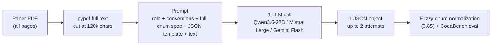
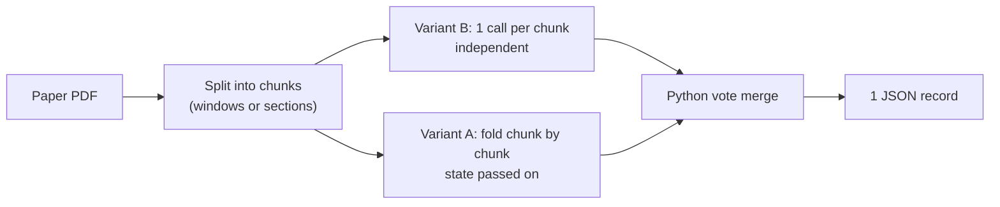
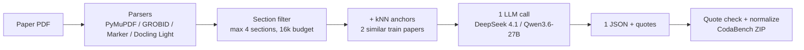

# BiodiversityExtraction2026-2027 [Lennard Subpipeline] — README

TU Berlin Advanced NLP, Shared Task C1 (required) + C2b (Biodiversity).
Goal: fill a structured German record from a paper PDF (habitats, species groups,
ecosystem types, biodiversity measures). Leaderboard metric: C1 Macro-F1.
Dev set: 100 papers with PDF (`data/gold/dev_100_ids.txt`).
All runs with scores: [docs/experiment_matrix.md](docs/experiment_matrix.md).

## 1. Task (exact assignment)

<details>
<summary><b>What the system reads and writes</b></summary>

Input: one scientific paper as PDF, in English or German, usually several thousand words.
Output: one structured record per paper — a list of German values per field.
Most fields are multi-label classification over fixed German enums
(habitat, biodiversity_level, ecosystem_type, species_group).
Taxa names and biodiversity variables are open extraction at document level (no spans,
no offsets — gold labels have none). All categorical values must match the schema enums exactly.

</details>

<details>
<summary><b>C1 — required for all teams (5 core fields)</b></summary>

- `habitat` (6 classes, e.g. Agrar- und Offenland)
- `biodiversity_level` (7 classes, e.g. Artenvielfalt)
- `ecosystem_type.category` + `ecosystem_type.term` (categories + 41 terms)
- `taxa.species_group` (e.g. Gefäßpflanzen, Fische)

</details>

<details>
<summary><b>C2b — Biodiversity (our chosen subtask)</b></summary>

- `taxa`: `scientific_name`, `german_name`, `species_group` (species level for few species,
  group term + `"-"` as scientific name for many species / whole groups)
- `biodiversity_variable`: the only true free-text field (e.g. Biomasse, Abundanz)
- `biodiversity_level`: as in C1
- `ecosystem_service`: `category` + `term` (long CICES codes)

</details>

<details>
<summary><b>Data, submission, scoring, rules</b></summary>

- **Data:** train 908, dev 100 papers with PDF (+ 800 dev records without PDF — chair export quirk),
  test 500 papers. PDFs are password-protected and copyrighted: for use inside our university only, never public.
- **Submission:** ZIP with exactly one `predictions.jsonl` (one JSON object per line, one per paper).
  Missing fields count as empty.
- **Scoring:** per paper and field, predicted set vs. reference set (exact match for enums;
  best-match BertScore for free text). Precision/recall/F1 per field, summed over papers.
  Leaderboard ranks C1 Macro-F1 (mean over the 5 core fields).
- **Limits:** one CodaBench account per team (CodaBench is the official competition platform that
  scores submissions); max 5 uploads/day (practice), max 3 total (test).
  Valid only without scoring errors and above random + majority baselines.

</details>

## 2. Data inspection

Our biggest findings on the train set (908 papers) — all scored on Dev-100 later.

<details>
<summary><b>Findings (click to expand)</b></summary>

- **Skew:** top-3 habitats cover ~75% of mentions; two biodiversity levels cover ~70%.
  Majority guessing alone doubles the random score.
- **Empty is often correct:** services 78%, ecosystem_type 50%, biodiversity_level 42%,
  biodiversity_variable 39%, taxa 27%, habitat 6%. The model must learn *when* to stay empty.
- **Free-text concentration:** 98 distinct biodiversity variables, but Abundanz (322),
  Artenzahl (230) and Biomasse (145) dominate.
- **Taxa convention:** group studies carry the group name plus `"-"` as scientific name
  (most frequent taxa value) — output `"-"` only when no single species is studied.
- **Gold noise:** ~76% of dev papers are clean, ~24% carry breadth labels, unwritten conventions
  (floodplain → running waters) or exact-match traps (author epithets).
- **Dev size:** 900 records, but only 100 have a PDF (confirmed chair export quirk).
  We evaluate on those 100 (`data/gold/dev_100_ids.txt`).

Full per-paper audit: [docs/dev_100_paper_audit_table.md](docs/dev_100_paper_audit_table.md)

</details>

## 3. Timeline: what we built and measured

### Phase 0 — trivial & classical baselines (`src/models/base_models/`)

Random 0.1006, majority 0.2055, dictionary 0.3438, CRF 0.3399, kNN 0.4793, LogReg 0.4677,
Naive Bayes 0.4799, **SVM 0.4897** (best single model), voting ensemble **0.5260** (best classical).
Runs on any local CPU in seconds — no provider, no API key, no GPU needed (that starts with Architecture 1).

<details>
<summary><b>ALL 9 BASE model results (click to expand)</b></summary>

| Model | Type | C1 | C1+C2b | Micro | Runtime | Seed | Script |
|---|---|---:|---:|---:|---:|---|---|
| random | trivial | 0.1006 | 0.0607 | 0.0600 | 0.03s | 42, 43, 44 | [random_baseline.py](src/models/base_models/random_baseline.py) |
| majority | trivial | 0.2055 | 0.1429 | 0.1403 | 0.03s | deterministic | [majority_baseline.py](src/models/base_models/majority_baseline.py) |
| dictionary | rule-based | 0.3438 | 0.2721 | 0.3216 | 10.7s | deterministic | [dictionary_baseline.py](src/models/base_models/dictionary_baseline.py) |
| crf | sequence labelling | 0.3399 | 0.2727 | 0.3110 | 32.3s | 42, 43, 44 | [crf_baseline.py](src/models/base_models/crf_baseline.py) |
| tfidf_logreg | classical ML | 0.4677 | 0.3657 | 0.3694 | 34.5s | 42, 43, 44 | [tfidf_logreg_baseline.py](src/models/base_models/tfidf_logreg_baseline.py) |
| bow_naive_bayes | classical ML | 0.4799 | 0.3140 | 0.3564 | 8.8s | deterministic | [bow_naive_bayes_baseline.py](src/models/base_models/bow_naive_bayes_baseline.py) |
| knn_retrieval | retrieval | 0.4793 | 0.3419 | 0.3610 | 9.3s | deterministic | [knn_retrieval_baseline.py](src/models/base_models/knn_retrieval_baseline.py) |
| tfidf_svm | classical ML | 0.4897 | 0.3675 | 0.3753 | 26.6s | 42, 43, 44 | [tfidf_svm_baseline.py](src/models/base_models/tfidf_svm_baseline.py) |
| ensemble_voting | classical ensemble | 0.5260 | 0.3783 | 0.3966 | 0.02s | 42 | [ensemble_voting_baseline.py](src/models/base_models/ensemble_voting_baseline.py) |

</details>

<details>
<summary><b>Details on the runs (click to expand)</b></summary>

<details>
<summary><b>random_baseline</b> — 0.1006 C1</summary>

Samples one allowed enum value per field uniformly at random, without reading any text.
Runs on 3 fixed seeds (42, 43, 44) and reports mean ± std.
This is the stochastic lower bound every real system must beat.


Find the full script here: [random_baseline.py](src/models/base_models/random_baseline.py)
</details>

<details>
<summary><b>majority_baseline</b> — 0.2055 C1</summary>

Predicts the most frequent train label per field (e.g. habitat "Agrar- und Offenland",
taxa scientific name "-"), fully deterministic.
Doubles the random score through class skew alone, so it is the second mandatory hurdle.


Find the full script here: [majority_baseline.py](src/models/base_models/majority_baseline.py)
</details>

<details>
<summary><b>dictionary_baseline</b> — 0.3438 C1</summary>

Matches bilingual keyword lists and a 1,834-entry species table against the title plus the
first two PDF pages only. Shows the first pages carry strong signal, but it collapses on
`ecosystem_type.term` (0.0952), where keywords are not enough.


Find the full script here: [dictionary_baseline.py](src/models/base_models/dictionary_baseline.py)
</details>

<details>
<summary><b>crf_baseline</b> — 0.3399 C1</summary>

Linear-chain CRF with distant BIO supervision and Viterbi decoding over the paper text.
Best of all classical models on open-vocabulary species names (scientific 0.2624, german 0.2421),
but weak on abstract document-level fields.


Find the full script here: [crf_baseline.py](src/models/base_models/crf_baseline.py)
</details>

<details>
<summary><b>tfidf_logreg_baseline</b> — 0.4677 C1</summary>

Word (1–2 gram) plus char (4–5 gram) TF-IDF with One-vs-Rest L2 logistic regression and
sparsity-aware thresholds. A strong classical benchmark that already beats every rule-based method.


Find the full script here: [tfidf_logreg_baseline.py](src/models/base_models/tfidf_logreg_baseline.py)
</details>

<details>
<summary><b>bow_naive_bayes_baseline</b> — 0.4799 C1</summary>

Complement Naive Bayes (alpha=0.5) on count vectors. Best on `ecosystem_type.category` (0.6154),
but scores exactly 0.0000 on ecosystem services, which caps its total.


Find the full script here: [bow_naive_bayes_baseline.py](src/models/base_models/bow_naive_bayes_baseline.py)
</details>

<details>
<summary><b>knn_retrieval_baseline</b> — 0.4793 C1</summary>

Retrieves the k=5 most similar train papers by cosine similarity and votes with similarity weights.
Best of all classical models on `ecosystem_type.term` (0.4330) — this result motivates the
few-shot RAG anchors used in all later LLM pipelines.


Find the full script here: [knn_retrieval_baseline.py](src/models/base_models/knn_retrieval_baseline.py)
</details>

<details>
<summary><b>tfidf_svm_baseline</b> — 0.4897 C1</summary>

One-vs-Rest linear SVM with sigmoid-mapped decision distances on TF-IDF features.
Best single classical model overall and strongest on `ecosystem_type.term` (0.4262).


Find the full script here: [tfidf_svm_baseline.py](src/models/base_models/tfidf_svm_baseline.py)
</details>

<details>
<summary><b>ensemble_voting_baseline</b> — 0.5260 C1</summary>

Approval voting over all 9 base models above, no training involved. Best classical result on Dev,
showing the models make complementary errors — the idea reused later for the cross-architecture LLM ensemble.


Find the full script here: [ensemble_voting_baseline.py](src/models/base_models/ensemble_voting_baseline.py)
</details>

</details>

All scored on the same Dev-100 with the official evaluator.

<details>
<summary><b>Calls & cost for 100 papers (click to expand)</b></summary>

- **0 LLM calls.** Everything runs on local CPU: all 9 baselines together take about 2 minutes.
- No provider, no API key, no GPU, no rate limits.

</details>

### Phase 1 — Architecture 1 (monolithic, `llm_zeroshot_guidelines.py`)

The whole paper goes into one prompt and all fields come out at once. Tested with three models:
Qwen3.6-27B (C1 0.5754) and Mistral Large (C1 0.5143) with logged scores, plus Gemini Flash as the
default provider. Papers run one after another through the API (rate-limited) — no GPU needed.

<details>
<summary><b>Setup Architecture 1 (click to expand)</b></summary>

- **No chunking.** The full pypdf text (all pages) goes into a single prompt per paper.
- **Hard cut.** Text is cut at 120,000 chars with a cut marker — long papers lose their tail.
- **One prompt.** German role + task + binding conventions + full official field spec (all enums)
  + JSON template + paper text.
- **One call.** Exactly one LLM call per paper — not parallel, not sequential, no state, no merging.
- **Strict output.** The answer must be one JSON object; up to 2 attempts on invalid JSON.
- **Fuzzy enum normalization (0.85).** Model strings rarely match the German enums exactly
  ("Fluss" vs. "Fließende Gewässer"), so each predicted string is mapped to the most similar
  official enum value — kept only at similarity ≥ 0.85, dropped otherwise.
- **Scoring.** Normalized predictions go through the official CodaBench evaluator.



<details>
<summary><b>Results (click to expand)</b></summary>

| Model | C1 | C1+C2b | Micro |
|---|---|---:|---:|
| Qwen3.6-27B | 0.5754 | 0.4149 | 0.4515 |
| Mistral Large | 0.5143 | 0.3751 | 0.3834 |

Qwen wins through less over-extraction (542 vs. 1,166 false positives). Gemini Flash is the
script default but has no logged Dev score.

</details>

Find the full script here: [llm_zeroshot_guidelines.py](src/models/architectures/llm_zeroshot_guidelines.py)

</details>

<details>
<summary><b>Example prompt (real, paper text shortened — click to expand)</b></summary>

System: *"Du bist ein Experte für die Annotation von Biodiversitäts-Forschungspublikationen
für eine deutsche Forschungsdatenbank. [...] Du antwortet ausschließlich mit validem JSON."*

User:
```
# Aufgabe
Extrahiere aus der folgenden Forschungspublikation die Felder gemäß der
Feldspezifikation. [...] Gib ausschließlich ein JSON-Objekt mit genau diesen Schlüsseln
zurück: habitat, biodiversity_level, ecosystem_type, taxa, biodiversity_variable,
ecosystem_service.

# Verbindliche Annotationskonventionen
- Output ONLY a single JSON object — no explanations, no markdown fences.
- Use the EXACT German enum strings [...], character for character [...].
- A field the study does not address gets an EMPTY list []. [...]
- Never invent values that are not supported by the text.
[... 4 more convention lines ...]

# Feldspezifikation (offizielle Schemas)
[... full enum lists per field ...]
# JSON-Ausgabeformat (Vorlage)
[... fixed JSON template with all 6 keys ...]

# Publikation
Titel: <title> / Jahr: <year> / Typ: <type>

## Volltext
<paper text, cut at 120,000 chars>
```

</details>

<details>
<summary><b>Calls & cost for 100 papers (click to expand)</b></summary>

- 1 LLM call per paper (+1 retry on invalid JSON) = **100–200 requests** per run.
- Measured wall time: Qwen3.6-27B ~80 min, Mistral Large ~128 min (rate-limited APIs).
- No GPU, no local compute beyond text parsing.

Phase-1 scores above; all Architecture-3 runs with scores: [docs/experiment_matrix.md](docs/experiment_matrix.md).

</details>

### Phase 2 — Architecture 2 (chunking: Variant A sequential, Variant B parallel)

Long papers do not fit one prompt, so the paper is split into chunks (text windows) and each
chunk gets its own LLM call. Runs via API (Qwen3.6-27B, Mistral Large, DeepSeek), 2–4 calls
per paper, merging in plain Python — no GPU needed locally.

#### Variant A — sequential (state fold)

Chunks are read in order; each call receives the label state of all previous chunks and updates it.
Early errors propagate through the whole paper. Rejected after C1 **0.1629** (first gen) — context
drift destroys early findings. Second gen (`llm_sequential_chunks.py`) re-tests the idea with
cleaner state handling; real runs pending.

#### Variant B — parallel (vote merge)

Each chunk is processed by an independent call; the per-chunk label sets are merged by voting in
Python. No call can infect another with early errors. First gen reached C1 **0.5622** (details below).

<details>
<summary><b>Setup: Architecture 2 (click to expand)</b></summary>

- **Chunk.** A paper is split into at most 4 windows of about 16,000 tokens (first gen) or into
  sections by headings (second gen). A chunk is just a slice of text, not a semantic unit.
- **Quote gate.** Every label must carry a verbatim quote from its chunk; quotes that cannot be
  found word-for-word in the chunk are dropped as hallucinations.
- **Field guidelines (v2).** Thorough per-field requirement texts in the prompt, e.g. what counts
  as `biodiversity_level` versus a mere measurement, or when a habitat label is warranted at all.
  They halved false positives (species_group FPs 144 → 76).
- **Term enums (E1).** The 46 ecosystem-type and 67 service terms are listed in the prompt with relaxed
  matching — the single biggest lever (+10 C1 points), because free-text terms died in strict normalization.
- Find the full scripts here: [llm_parallel_chunking.py](src/models/architectures/llm_parallel_chunking.py),
  [llm_sections_pipeline.py](src/models/architectures/llm_sections_pipeline.py) (first gen),
  [llm_parallel_chunks.py](src/models/architectures/llm_parallel_chunks.py),
  [llm_sequential_chunks.py](src/models/architectures/llm_sequential_chunks.py) (second gen, real runs pending)



</details>

<details>
<summary><b>Results (click to expand)</b></summary>

| Setup | Model | C1 | C1+C2b | Micro |
|---|---|---:|---:|---:|
| v1 baseline (quote gate only) | Qwen3.6-27B | 0.4318 | 0.2885 | 0.3152 |
| v2 + field guidelines | Qwen3.6-27B | 0.4565 | 0.3339 | 0.3566 |
| E1 + term enums | Qwen3.6-27B | 0.5593 | 0.4144 | 0.3923 |
| E1 + term enums | DeepSeek 4.1 | 0.5622 | 0.4244 | 0.4163 |
| E2 + text cleaning | Qwen3.6-27B | 0.4463 | 0.3321 | 0.3633 |
| v1 baseline | Mistral Large | 0.4056 | 0.2740 | 0.3112 |
| Sections, English-first + mapping | Qwen3.6-27B | 0.4476 | 0.3090 | 0.3059 |
| Sections, direct German | Qwen3.6-27B | 0.2498 | 0.2210 | 0.2191 |

Term enums (E1) explain almost the whole gap to monolithic: without them, `ecosystem_type.term`
collapsed to 0.000. Second gen (`llm_parallel_chunks.py`) re-tests voting with section chunks;
real runs pending.

How to read the rows: *English-first + mapping* means the model extracts in English and Python
maps the labels onto the German enums afterwards — needed because over 85% of the papers are
written in English, so German verbatim quotes rarely match. *Direct German* skips that step and
prompts plus matches in German directly, which fails much more often (0.2498 vs. 0.4476).

</details>

<details>
<summary><b>Example prompt (real, section text shortened — click to expand)</b></summary>

```
# Task
Extract all labels that THIS section evidences about the study. Rules:
- A label counts only if the section contains explicit textual evidence.
- Missing information means an empty list []. An empty section is NOT evidence against a label.
- "quote" must be copied VERBATIM from the section text (max ~25 words), or the label is invalid.
- Use ONLY the listed English labels for enum fields.
- For ecosystem_type.term / ecosystem_service.term output the exact German term if you know it,
  else a short English description, else null.
- Free-text values (biodiversity_variable, taxa names) in German / Latin binomials.
- taxa: one entry per distinct taxon; collective_term=true for broad groups (fishes, birds,
  vascular plants, ...) [...]

# Output JSON schema
[... one object per field, each with "label" + verbatim "quote" ...]

# Section: <heading>
<section text>
```

Variant A appends the running label state plus: keep labels that still hold, ADD new labels from
THIS section, REMOVE contradicted ones — same JSON structure back.

</details>

<details>
<summary><b>Calls & cost for 100 papers (click to expand)</b></summary>

- Variant B: up to 4 calls per paper = **~250–400 requests** per run.
- Variant A: up to 4 calls per paper, sequential = **~250–400 requests**, slower wall time.
- Measured wall time (E1 config): DeepSeek 4.1 ~67 min, Qwen3.6-27B ~203 min (rate-limited).
- No GPU, merging is plain Python.

</details>

### Phase 3 — Architecture 3 (RAG-anchored sections, `llm_rag_sections.py`, current main pipeline)

16k budget over max 4 sections, kNN anchors, 1 call. Parser axis: PyMuPDF 0.5798 →
GROBID 0.5957 → Marker 0.5985 → Docling Light 0.5634. The parsers turn PDF into text differently:
PyMuPDF is a fast plain-text extractor (no structure); GROBID is a structure-aware academic
parser (detects abstract, methods, results via TEI sections); Marker converts layout to markdown;
Docling is IBM's layout model (it can do OCR plus table structure); we run it reduced as
**Docling Light** — no OCR, plain markdown export. Her full variant is compared below.

<details>
<summary><b>Setup: Architecture 3 (click to expand)</b></summary>

- **Section filter.** Each paper is split into semantic sections (abstract, methods, results, …);
  references and boilerplate are dropped. At most 4 sections share a 16,000-char budget.
- **RAG anchors.** RAG means the prompt is augmented with retrieved examples. A TF-IDF cosine
  search compares the current paper against all 908 train papers and picks the 2 most similar
  ones (3 in v4 mode); their gold database records go into the prompt verbatim. The model thus
  sees how human annotators labelled comparable papers — which labels co-occur, when fields stay
  empty, how fine-grained taxa get. Example: for a lake-fish paper the anchors are other lake and
  fish studies with their exact gold JSON, so the model copies the granularity instead of guessing.
- **One call.** Filtered sections plus anchors plus the full enum spec go into a single prompt;
  the answer is one JSON object with a verbatim quote (3–60 words) per label.
- **AutoParser router.** GROBID is asked first; if its output has 3 or fewer sections or keeps
  less than 65% of the plain-text length, the paper is routed to Marker instead (12 of 100 papers).
- **Post steps.** Python checks every quote against the text, normalizes names and enums, drops
  unverified labels, and exports the CodaBench ZIP. Runs via API (DeepSeek 4.1 / Qwen3.6-27B),
  1 call per paper — no GPU needed locally.



</details>

<details>
<summary><b>Example prompt (real v4, enums + sections shortened — click to expand)</b></summary>

```
## Task
Read the text below (Title: <title>) and fill the record described in "Fields".
Work through the reasoning steps first, then give the record.

## Fields
1. habitat (choose 0..n): [<6 German enums>]
2. ecosystem_type (choose 0..n pairs of category and term; term must belong to its category):
   [... category → terms map ...]
3. biodiversity_level (choose 0..n): [<7 German enums>]
4. taxa (0..n entries): species_group (choose 1): [<16 groups>]; plus scientific_name and
   german_name (rule R7).
5. ecosystem_service (choose 0..n pairs; term is optional):
   category: [<3 categories>] / term: [<67 CICES terms>]

## Hard rules
R1 Allowed values only: copy values character by character.
R2 No label without evidence: every label needs a verbatim "quote" (3 to 60 words [...]).
R3 Main subject only: label what THIS document is mainly about [...]. Ignore single examples,
   background, or citations of other work.
R4 Empirical rates: habitat ~94% (usually 1), taxa ~73%, biodiversity_level ~58%,
   ecosystem_type ~50% (usually <=1 pair), ecosystem_service ~22%. Empty is valid except usually habitat.
R5 No world knowledge about locations/methods not in text [...].
R6 Consistency: ecosystem_type term must match its category.
R7 Taxa names: scientific names WITHOUT author/year [...]; at most 10 taxa entries [...].
R8 Answer with ONE JSON object only.

## Reasoning steps (write into "reasoning", max 120 words)
S1 Study system -> habitat, ecosystem_type / S2 Organisms -> taxa / S3 Measurements ->
biodiversity_level / S4 Services -> ecosystem_service / S5 Self-check [...] drop failures.

## Output structure
{"reasoning": "S1: ... S5: ...", "labels": [{"field": ..., "quote": "<verbatim quote>"}, ...]}

## How the database labelled similar documents (training examples)
[... 3 most similar train papers with their gold labels ...]

## Text
<<< ### SECTION: <name> / <section text, 16k budget> >>>
```

</details>

<details>
<summary><b>Calls & cost for 100 papers (click to expand)</b></summary>

- 1 LLM call per paper (+ retries) = **~100–200 requests** per run.
- Measured wall time (GROBID sections): DeepSeek 4.1 ~49 min, Qwen3.6-27B ~97 min.
- No GPU for the run itself (parsing caches are prebuilt on CPU/GPU once, then reused).

</details>

#### Parser axis (within Phase 3)

Parsing was optimized 18–21 Nov: same prompt and pipeline, only the PDF-to-text input changed.
GROBID ran as a Docker service on our home benchmark server; Marker and Docling Light were converted
once on a second home machine (CPU) and cached as markdown. Baseline is always plain PyMuPDF full text.

<details>
<summary><b>Parser results (click to expand)</b></summary>

| Parser | DeepSeek 4.1 C1 (Δ vs PyMuPDF) | Qwen3.6-27B C1 (Δ vs PyMuPDF) |
|---|---|---:|
| PyMuPDF (baseline) | 0.5798 | 0.5539 |
| GROBID | 0.5957 (+0.016) | 0.5706 (+0.017) |
| Marker | 0.5985 (+0.019) | 0.5837 (+0.030) |
| Docling Light (no OCR) | 0.5634 (−0.016) | 0.5613 (+0.007) |
| AutoParser router (offline) | 0.6056 (+0.026) | 0.5839 (+0.030) |

</details>

Lesson: structure-aware parsing beats raw text on both models; Marker wins brochures and reports
where GROBID drops text, GROBID wins structured papers — hence the router. Docling Light loses.
Minh's full Docling (OCR on) was added on 26 Nov under the v4 prompt instead of the baseline prompt,
so it sits in the v4 table below: 0.7 C1 points behind AutoParser on DeepSeek 4.1 (within noise),
3.2 points ahead on Qwen3.6-27B.

<details>
<summary><b>Router analysis (click to expand)</b></summary>

If we could magically pick the best parser per paper, we would reach C1 0.6914 with DeepSeek 4.1
and 0.6827 with Qwen3.6-27B — that is the headroom. Counted strictly paper by paper, GROBID wins
most often (16 papers on each model), followed by PyMuPDF, Marker and Docling Light in varying order.
Two document types stand out on both models. When GROBID loses over a third of the text
(`g_ratio` below 0.65, 9 papers), Marker wins by about 10 points on DeepSeek and 26 points on
Qwen. When GROBID finds 3 or fewer sections (12 papers), Marker wins by about 5 and 17 points.
On cleanly structured papers, GROBID leads on the full score (C1+C2b 0.4733 with DeepSeek,
0.4572 with Qwen). The offline 2-rule router simply sends those two buckets to Marker and
everything else to GROBID — no API calls needed — and reaches C1 0.5839 with Qwen and
0.5938 with DeepSeek.

</details>

<details>
<summary><b>Our Docling Light vs. Minh's full Docling (click to expand)</b></summary>

Same engine (IBM Docling), different setup:

| | Ours (light) | Minh's |
|---|---|---|
| OCR | off — scanned pages yield nothing | on — reads scans too |
| Table structure | on | on |
| Output | flat markdown text | full JSON document |
| Page info | lost | page numbers plus `[page N]` markers in the text |
| Use in prompt | split into sections, 16k budget | whole text in one call |
| C1 in our pipeline | 0.5634 / 0.5613 | untested — the pending fair rerun |

Our Docling Light was built for speed (CPU, minutes per paper). Hers costs GPU hours per 100
papers but keeps everything the quote checker needs.

</details>

#### OFAT optimizations (within Phase 3)

OFAT means One Factor At a Time: our binding experiment rule — change exactly one thing per run
against its immediate baseline, measure the delta, log the decision the same day. With only 100
papers and noisy metrics, bundled changes would hide what actually helped, so no combined
effect ever enters the report untested. Every OFAT test runs on **both** models — DeepSeek 4.1
via the SAIA academic cloud and Qwen3.6-27B via the HU-Berlin bridge — because optimizations
do not transfer between providers (see
`--evidence-gates` below). All comparisons live in [docs/experiment_matrix.md](docs/experiment_matrix.md)
(flags column) with the full experiment tables and verdicts in [docs/experiment_log.md](docs/experiment_log.md).

<details>
<summary><b>The three OFAT tests (click to expand)</b></summary>

- **`--detox-rag` (rejected, −5.6 C1).** Idea: retrieve anchors with bilingual character-level
  TF-IDF and strip species names from them, so the model cannot copy neighbor taxa. Result:
  grounding collapsed — masking taxa removes domain signal instead of leakage.
- **`--role-budget` (rejected).** Idea: weight the section budget toward methods and results
  (35% each), where the facts live. Result: no gain over the even split, sometimes worse —
  abstracts and discussions carry signal too.
- **`--evidence-gates --clean-taxa` (kept for DeepSeek 4.1).** Gates drop sparse-field
  predictions (services, levels) without a verbatim quote; clean-taxa removes fabricated taxa
  placeholders and unifies name spellings. Result: new best on Marker (**C1 0.6040**) and best
  Micro on GROBID — but the same gates hurt Qwen3.6-27B, so they stay provider-specific.

| OFAT variant (vs. immediate baseline) | DeepSeek 4.1 C1 (Δ) | Qwen3.6-27B C1 (Δ) | Verdict |
|---|---|---:|---|
| `--detox-rag` on GROBID (0.5957) | 0.5399 (−0.056) | — | rejected |
| `+ --role-budget` (on detox) | 0.5446 (+0.005) | — | rejected |
| `+ --ev --ctaxa` (on detox, GROBID/Marker, both models) | 0.5588 / 0.5676 | 0.5654 / 0.5520 | rejected (detox poisons all) |
| `--role-budget` clean (GROBID, no detox) | 0.5815 (−0.014) | — | rejected |
| `--ev --ctaxa` clean, Marker | **0.6040** (+0.006) | 0.5625 (−0.021) | kept for DeepSeek 4.1 only |
| `--ev --ctaxa` clean, GROBID | 0.5959 (+0.000) | 0.5434 (−0.027) | kept for DeepSeek 4.1 only (Micro best) |

Full per-field numbers: [docs/experiment_matrix.md](docs/experiment_matrix.md), full narrative: [docs/experiment_log.md](docs/experiment_log.md).

</details>

#### Minh integration (within Phase 3)

Minh, a fellow student, built her own pipeline F next to ours on branch
[`minhanh_testing`](https://github.com/tAleksiev2003/BiodiversityExtraction2026-2027/tree/minhanh_testing):
Full Docling JSON per paper, first-page texts for similarity search, the 3 most similar train papers as
examples, then one full-text call with her v4 prompt plus a second call only for
`biodiversity_level`. A verbatim checker drops labels without quotes; post rules drop
unsupported services and ecosystem types. Her scores climbed from C1 0.6644 (v4 + new model)
to 0.6732 (level prompt) to **0.6881** (eco-type rule). On 23 Nov we added her single
building blocks to our pipeline one by one (`--self-check-reasoning`, `--per-label-quotes` on the
23rd; `--eco-category-map`, `--level-prompt` on the 24th) — all rejected. On **24 Nov** we adopted
her complete cohesive v4 prompt as a whole instead, plus `--bilingual-knn`. Only the whole package
worked. Tested with DeepSeek 4.1 (SAIA academic cloud)
and Qwen3.6-27B (HU-Berlin bridge).
Her code: [pipeline F](https://github.com/tAleksiev2003/BiodiversityExtraction2026-2027/tree/minhanh_testing/src/pipelines/full_text.py),
[v4 prompt](https://github.com/tAleksiev2003/BiodiversityExtraction2026-2027/tree/minhanh_testing/config/prompts/extraction_v4.txt),
[retrieval](https://github.com/tAleksiev2003/BiodiversityExtraction2026-2027/tree/minhanh_testing/src/retrieval.py).
Our side: flags in [llm_rag_sections.py](src/models/architectures/llm_rag_sections.py).

<details>
<summary><b>Flag glossary (click to expand)</b></summary>

- **v4** = Minh's cohesive prompt version 4 (train examples + document focus + quote check, see setup above).
- **`--full-text`** = put the whole untruncated parser text in the prompt instead of the 16k section budget.
- **`--bilingual-knn`** = retrieve the example papers with character n-gram TF-IDF that matches German, English and Latin taxon names (without stripping taxa like detox does).
- **`--clean-taxa`** = post-step that deletes made-up taxa placeholders and unifies name spellings.
- **`--self-check-reasoning` (s5)** = explicit reasoning steps S1–S5 plus taxa rules R7 in the prompt.
- **`--per-label-quotes` (plq)** = one flat label list with a 3–60-word verbatim quote check per label.
- **`--eco-category-map` (ecomap)** = hard-coded category hints for ecosystem types.
- **`--level-prompt` (lvl)** = extra field prompt just for `biodiversity_level`.
- **`--german-plural-norm` (gpn)** = maps a predicted German taxa name to its unique train-vocabulary variant (e.g. Seehund -> Seehunde); never touches names already in the vocabulary (so singular-only conventions like 'Kegelrobbe' survive).

</details>

<details>
<summary><b>Single blocks, all rejected (click to expand)</b></summary>

| Block added to AutoParser baseline | DeepSeek 4.1 C1 | Qwen3.6-27B C1 | Verdict |
|---|---|---:|---|
| `--self-check-reasoning` (S1–S5 + R7 taxa rules) | 0.5861 | 0.5459 | rejected |
| `+ --per-label-quotes` (3–60 word verbatim check) | 0.5856 | 0.5304 | rejected |
| `--eco-category-map` | 0.5766 | 0.5689 | rejected |
| `--level-prompt` | 0.5770 | 0.5474 | rejected |

Baselines at the time: DeepSeek 4.1 at 0.6056, Qwen3.6-27B at 0.5839. Every single block lost C1 on both models.

</details>

<details>
<summary><b>Cohesive v4 family, adopted (click to expand)</b></summary>

| v4 variant (AutoParser) | DeepSeek 4.1 C1 / C1+C2b / Micro | Qwen3.6-27B C1 / C1+C2b / Micro |
|---|---|---|
| baseline, no v4 (`--ev --ctaxa`, offline router, pre-cache) | 0.6056 / 0.4469 / 0.4424 | 0.5839 / 0.4317 / 0.4237 |
| `--ctaxa --v4` (16k sections, redone 27 Nov) | 0.5847 / **0.4784** / **0.4994** | **0.5700** / 0.4122 / **0.4279** |
| `+ --full-text` (redone 27 Nov) | 0.5759 / 0.4497 / 0.4632 | 0.5602 / 0.4053 / 0.4257 |
| `+ --bilingual-knn` (redone 27 Nov) | **0.6102** / 0.4715 / 0.4901 | 0.5604 / **0.4166** / 0.4264 |
| `+ full + bilingual-knn` (redone 27 Nov) | 0.5987 / 0.4621 / 0.4733 | 0.5562 / 0.4016 / 0.4059 |
| Docling Light instead of AutoParser (1:1 proof, pre-cache) | 0.5765 / 0.4421 / 0.4527 | 0.5549 / 0.3816 / 0.3633 |
| Minh's full Docling (OCR on, page markers) instead of AutoParser — fair rerun, 26 Nov | 0.5883 / 0.4626 / 0.4804 | **0.5894** / 0.4233 / **0.4426** |

**Redo variance warning (27 Nov).** Rerunning the identical v4 configs on the complete caches moved
C1 by −2.7 to +0.9 points on DeepSeek 4.1 and −2.5 to +1.3 on Qwen3.6-27B. Single-run differences
below ~2 C1 points are noise for us — including several small OFAT deltas logged earlier. The best
confirmed run is now `--v4 --bilingual-knn` (16k) at 0.6102 / 0.4715 / 0.4901; `--full-text` lost its
old +0.7 C1 edge (variance). The Docling rows above are still pre-cache — rerun the Docling side
before quoting the exact gap again. Full deltas: section 3f in
[docs/experiment_log.md](docs/experiment_log.md).

The full v4 prompt — train examples, document focus, 3–60-word quote check — gives the best
C1+C2b and Micro of every non-rawft run (and the first Micro above 0.50 came from it, before the
redo moved that run). Parser side, both sides on fresh runs: our AutoParser (16k) vs Minh's full
Docling JSON is now a near-tie on DeepSeek 4.1 (C1 0.5847 vs 0.5883, AutoParser ahead on C1+C2b
and Micro), and full Docling wins all three metrics on Qwen3.6-27B (C1 +1.9). The old claim
"AutoParser beats Docling by 2.2–2.6 C1" compared two pre-cache runs and does not survive the
redo variance (see warning above) — the Docling Light rows need their own redo before any exact
gap is quoted again.

</details>

#### `--raw-fulltext` (within Phase 3, 25 Nov)

Unfiltered full text, 1 call, on top of `--clean-taxa --v4-prompt`. DeepSeek 4.1: **0.6102** / 0.4822 / 0.5006
(C1 / C1+C2b / Micro) — tied-best C1 with the post-redo `--v4 --bilingual-knn` run, best C1+C2b and Micro
overall — but it is a pre-cache run and not production-ready: a paper longer than the context limit comes back
empty (1 paper on DeepSeek 4.1 at 1,048,576 tokens, 3 papers on Qwen3.6-27B), so it needs a split fallback
first. Qwen3.6-27B: 0.5458 / 0.4029 / 0.4136, rejected there.

#### Catch-up on the complete caches (26–27 Nov, within Phase 3)

All Dev parser caches are complete since 26 Nov: Marker 100/100, Docling Light 100/100, Minh's full
Docling JSON 100/100, GROBID 99/100 (V2BVMBPF has no text anywhere). Three isolated tests ran on them,
each on both models. The first row is the reference (C1 / C1+C2b / Micro); the other rows give
the change in points against their baseline:

| Test | DeepSeek 4.1 | Qwen3.6-27B | Verdict |
|---|---|---|---|
| AutoParser `--clean-taxa`, no v4 — new no-v4 reference | 0.5883 / 0.4400 / 0.4426 | 0.5689 / 0.4047 / 0.4083 | reference |
| v4 prompt on top of it (post-redo) | −0.4 / +3.8 / +5.7 | +0.1 / +0.8 / +2.0 | C1 flat within variance; C1+C2b and Micro up on DeepSeek 4.1 only |
| `--level-prompt` (Minh's second call for `biodiversity_level`) | −0.4 / +0.5 / −0.2 | −2.2 / +0.4 / +0.2 | rejected again on both models |
| Minh's full Docling JSON instead of AutoParser (both `--clean-taxa --v4-prompt`) | +0.4 / −1.6 / −1.9 | +1.9 / +1.1 / +1.5 | fair rerun: on Qwen3.6-27B full Docling wins all three metrics |

**The 26 Nov redos did not recompute.** The catch-up queue meant to rerun the v4 family and Marker on the
complete caches. Each of the 8 runs ended after 2–3 seconds with `resumed: 100` and 0 papers processed:
the pipeline resumes from its checkpoint file, and the queue never removed the finished checkpoints.
So every AutoParser v4 number from 24–25 Nov and both Marker `--ev --ctaxa` numbers were from
before the complete caches. Fixed on 27 Nov with `scripts/run_redo_queue.sh`: it archives the run,
deletes the checkpoint and requests all 100 papers again (old predictions kept in
`outputs/redo_backup/`). **Redos finished 27 Nov (10/10, 0 errors):** the biggest mover was
`--full-text` on DeepSeek 4.1, down 2.7 C1 points to 0.5759; the biggest winner was
`--v4 --bilingual-knn` (16k), up to 0.6102 — now the best confirmed run. Key lesson: identical
configs moved by up to ±2.7 C1 points between runs, so small OFAT deltas are noise; details and
the full delta table in section 3f of [docs/experiment_log.md](docs/experiment_log.md).

**Minh's pipeline on our server.** Her pipeline F ran on `lenlenovo` with our PDFs, gold files and
schemas (25 Nov, 217 fresh requests). Scored with our evaluator on the same 100 papers:
**C1 0.6508 / C1+C2b 0.5389 / Micro 0.5032**. Against our best single run that is +4.0 C1 points
(CI +0.1 to +8.0) and +5.6 C1+C2b points (CI +1.1 to +10.5), with Micro equal. She wins on
`ecosystem_service` (category 0.522 vs 0.353, term 0.400 vs 0.200) and on `ecosystem_type`; we are
ahead only on taxa names. Open: her README reports C1 0.6881 for the same defaults while the repro
gives 0.6508 (unexplained), and her neighbour-based service rule has never been tested in our pipeline.
Bootstrap tables and per-field comparison: section 3f in [docs/experiment_log.md](docs/experiment_log.md).

## 4. Single sources of truth (no duplicates)

- All 52 Architecture-3 runs with scores, plus every older architecture in table 3 of the same file: [docs/experiment_matrix.md](docs/experiment_matrix.md)
- Every decision with delta: in the phase sections above, full tables in [docs/experiment_log.md](docs/experiment_log.md)
- Gold problems per paper (with legend): [docs/dev_100_paper_audit_table.md](docs/dev_100_paper_audit_table.md)
- Overall ranking: [docs/experiment_matrix.md](docs/experiment_matrix.md) (table 3 lists every run across all architectures, regenerated 27 Nov; [docs/leaderboard_summary.md](docs/leaderboard_summary.md) stays as historical snapshot)

## 5. Open work

Parser caches pulled and verified on 26 Nov. Done on them: isolated clean-taxa run, `--level-prompt`
re-test, fair Docling re-match, Minh repro (results in "Catch-up" above) and the true redos of the
v4 family + Marker on 27 Nov (results in "Catch-up" and section 3f). Still open: redo the Docling
Light v4 pair and the rawft run (both pre-cache), the per-paper matrix in evaluator, variance test
with fresh requests, clean up the batch directories on the GPU server and on `lenserver-hp`.
GROBID stays 99/100 (chunked fill recovered 8 of 9; V2BVMBPF has zero text anywhere).
Full per-field error analysis: [docs/error_analysis_fields.md](docs/error_analysis_fields.md).

### Queued OFAT runs (by expected score gain, cheapest first, each on both models)

1. **Flag pricing on the confirmed recipe** (queued 27 Nov, waits for redo2): recipe minus
   `--clean-taxa` → `autoparser_v4_biknn`, recipe plus `--evidence-gates` →
   `autoparser_ev_ctaxa_v4_biknn`; baselines 0.6102 (DeepSeek) / 0.5604 (Qwen).
2. **Budget ×4** (new `--budget-chars` flag, queued): 64k instead of 16k characters across
   sections, 1 call unchanged — targets eco_type/service content cut off today. The Minhs-repro
   comparison says this is where her pipeline wins (3–4× more document content).
3. **Level rules folded into the main prompt** (new `--level-fold` flag, queued): Minh's level_v1
   rules (enum definitions + base rates + main-subject rules) in the v4 prompt instead of a second
   call — the second call itself lost C1 twice; the fold is untested (biodiversity_level is the
   biggest single C1 lever).
4. **Neighbour-based service rule** (from Minh's pipeline F, implemented as `--service-gate`,
   queued as validate3): drop a paper's ecosystem services when none of its similar training
   papers has any. Train-derived rule — see the overfitting note in the log (3f): the rule comes
   from train statistics, only its adoption decision uses dev, and it stays threshold-free to
   keep that honest.
5. Collective-group rule for `species_group` + collective-taxa second question.
6. Water mapping + eco-type rule (two C1 fields move together).
7. Taxa-aware budget / dedicated taxa pass + translated names with English evidence.

### Future hypotheses (not started)

- **Neighbour-based service rule (from Minh's pipeline F).** Drop a paper's ecosystem services
  when none of its similar training papers has any. Never tested in our pipeline; it targets our
  weakest precision (`ecosystem_service.term` 0.125) and is where her pipeline gains most.
  (The fair Docling rerun that used to be listed here is done — see "Catch-up" above.)
- **Level decision into one prompt.** She spends a second call per paper on `biodiversity_level`;
  hypothesis: folding the level rules into the main prompt keeps the gain and halves the calls.
- **Cheap pre-filter router — validated offline 27 Nov** (`scripts/prefilter_router_analysis.py`,
  0 API calls): 71–72 of 100 papers have no strict per-paper parser winner (per-paper C1 margin
  > 0.02), so most papers do not need a choice. For the rest, two cheap signals work and survive
  5-fold cross-validation with stable thresholds (chars < 15k, headings ≥ 1, pages ≥ 25 chosen in
  4/5 folds on both models): **papers ≥ ~25–40 pages → full Docling JSON wins big on those**
  (routed C1 0.6141 vs router 0.5888 on DeepSeek, Δ +2.5, bootstrap CI [+0.9, +4.2], excludes 0;
  CV mean 0.6176 vs 0.5862; Qwen +1.6, CI includes 0) and **scans/no text layer → Marker**
  (small but consistent). Cost stays low: the long-paper route only needs GPU OCR for ~15–25
  papers. **Train check running:** the dev set is long-paper-heavy (41 % vs. 19 % on train), so
  the rules are now verified on the 908 training papers — signal audit done (see
  `experiment_log.md` §4c), 46-paper downstream check queued (`bio_trainverif`, GROBID vs.
  Docling vs. cheap route on train labels, self-excluded few-shots). After it holds, the rules
  move into stage 1 of `--auto-parser` and get a live Dev-100 OFAT.
- **German names: translation consistency, not gate relaxation.** Measured (27 Nov,
  `german_name_mechanism.py`): the DB pairs 93 % of taxa entries with a German name (0 latin-only
  entries) — 63/100 dev papers carry German gold names, 41 have them literally in the text
  (German-language papers), 22 are English papers needing translation. On those 22 we score
  F1 0.38 (P 0.42 / R 0.34) and DO emit 45 German names with English quotes — so the quote gate
  is NOT the blocker (old hypothesis disproved). The misses: 19 of 56 pair to a Latin name we
  predicted correctly (pure translation miss; a train-derived Latin->German glossary of 1524
  pairs would fix 8), the rest are species we never detected or collective terms (e.g.
  "Wildbestäuber"). Planned fixes: pairing rule in the prompt (scientific_name => also give the
  German name, translate if needed) + glossary post-normalisation inside clean-taxa.
  Implemented already: `--german-plural-norm` — the smallest safe piece of that plan
  (train-vocabulary-driven, unique variant only, unit-tested; measured +1 label on dev,
  so it skips a separate OFAT and rides in the production full-set run).
  Measured 27 Nov (`german_leak_check.py`): we also emit 24–32 German names on the 37 papers
  without gold taxa — pure FPs; emptying them would raise german_name F1 by +2.1–2.3 points.
  The pairing rule trades that leak against the ~19 missed pairings, so it runs as an OFAT
  (validate4 queue) instead of being adopted by assumption.

## 6. Limitations: where we still fail

Counted over 7 older pipelines (2 providers × 3 architectures + ensemble, pre-v4): papers no
run ever got right per field. Taxa names are the biggest gap by far; the per-paper rule will
refresh this table automatically for newer runs.

| Field | Papers never right (of 100) | Hit rate |
|---|---|---:|
| `taxa.scientific_name` | 47 | 0.27 |
| `taxa.german_name` | 45 | 0.25 |
| `biodiversity_level` | 30 | 0.48 |
| `taxa.species_group` | 25 | 0.49 |
| habitat | 16 | 0.69 |
| `ecosystem_type.term` | 15 | 0.53 |
| `ecosystem_type.category` | 9 | 0.63 |
| `ecosystem_service.term` | 6 | 0.79 |
| `ecosystem_service.category` | 5 | 0.80 |

<details>
<summary><b>Worst example papers per field (click to expand)</b></summary>

Same 3 papers fail almost everything. We read each one; per-paper hypotheses below.
Services look easy (0.79+) only because empty predictions count when gold is empty too.

- **habitat (16 never right):** `3LGPK6BL`, `PBV2BUX6`, `8UVBVFHS`.
- **biodiversity_level (30):** `3LGPK6BL`, `PBV2BUX6`, `6G2THNDX`.
- **ecosystem_type category (9) / term (15):** `3LGPK6BL`, `PBV2BUX6`, `HNT6RCEA`.
- **species_group (25):** `3LGPK6BL`, `PBV2BUX6`, `6G2THNDX`.
- **scientific / german name (47 / 45):** `3LGPK6BL`, `PBV2BUX6`, `6G2THNDX`.
- **services (5–6):** `6G2THNDX`, `UGNPXL8B`, `7AYVH7FI`.

`3LGPK6BL` — 249-page German dissertation on floodplain forest history and vegetation. Gold labels
waters + soil as habitats and running waters as ecosystem type *for a forest study* (the known
floodplain annotator convention), and lists "Auenvegetation" (vegetation, not a taxon) as the taxa
group. Hypothesis: a model that reads "forest" predicts forest habitat and tree taxa — and misses
a convention no text evidence supports. Book length additionally pushes species lists past the budget.

`PBV2BUX6` — 13-page study on oribatid mites in forest microhabitats. The gold record is empty
(status + ID only, no labels at all). Hypothesis: pure gold gap — every correct prediction (forest,
mites) counts as a false positive, so this paper is unwinnable for any system.

`6G2THNDX` — 489-page federal Rhine report (a book, not a study). Gold mixes 8 taxa entries:
Latin collectives (`Pisces`, `Aves`) next to German-only groups (`Algen`, `Makrozoobenthos`) and a
German word in the Latin field (`Invertebraten`). Hypothesis: exact matching punishes every
near-miss, the budget cuts the species lists at the back, and reports answer "what is it about"
differently than studies.

`8UVBVFHS` — textbook excerpt on Central European forests (29 pages shown). Gold claims 4 habitats
and 2 biodiversity levels but zero taxa, types, or services. Hypothesis: textbooks mention
everything and study nothing — models either over-predict from the text or stay empty and miss
the breadth labels. Natural score ceiling.

`HNT6RCEA` — 11-page grassland study on soil arthropods. Gold taxa are taxonomically sloppy:
`Diplopoda` (millipedes) and `Chilopoda` (centipedes) filed as `Insekten` (insects), which they are
not. Hypothesis: a model that knows its taxonomy predicts the right groups and still mismatches
the sloppy gold — correct knowledge punished.

`UGNPXL8B` — 10-page review on biocontrol in agroecosystems (a review, not a primary study).
Gold has no services although pest control is the topic, and only ultra-broad taxa (`Arthropoda`,
`Plantae`). Hypothesis: reviews trigger service predictions that gold never rewards, and broad
groups offer no exact-match grip.

`7AYVH7FI` — 10-page Blue Carbon paper: coastal ecosystems as carbon sinks. Gold has no
ecosystem service although carbon sequestration *is* the paper's subject (known missing label).
Hypothesis: same as above — the model is right about the service and gets punished for it.

</details>

## 7. Next steps to milestone 2

Working pipeline as of today: Architecture 3 with **AutoParser router**, **`--clean-taxa`**,
**Minh v4 prompt + `--bilingual-knn`**, 16k budget, 1 call per paper, provider **DeepSeek 4.1**
(redone on the complete caches 27 Nov: **C1 0.6102 / C1+C2b 0.4715 / Micro 0.4901** — best
confirmed run; the rawft variant still holds the best C1+C2b 0.4822 and Micro 0.5006 but is
pre-cache and lacks the token-limit fallback). Run-to-run variance is ±2–3 C1 points (see redo
warning in phase 3), so treat small OFAT deltas as noise.

**Efficiency (vs. Minh's pipeline F, the strongest system):** our preprocessing is CPU-only and
takes seconds per paper — GROBID (a structure parser, ~88 % of papers) plus Marker (a layout
parser, ~12 %) — while her Docling-with-OCR conversion of every PDF needed a university GPU
server. At inference we send **1 call per paper** (16k characters of text), she sends **2 calls**
(full text + a second call only for `biodiversity_level`). Cost ranking of the parsers, cheapest
first: PyMuPDF (plain text, <0.1 s) < GROBID (seconds, CPU) < Marker (~5–15 s, CPU) < Docling
Light (CPU, minutes) < full Docling with OCR (GPU-class). We trade roughly −4 C1 points
(−6 %) for that; her advantage sits in `ecosystem_service` and `ecosystem_type`, which the
queued optimizations below target.

**Next, per limitation (see [limitations](#6-limitations-where-we-still-fail) and [error analysis](docs/error_analysis_fields.md)):**

1. Two pipelines for the milestone, decided: **Minh's pipeline F is the submission base**
   (C1 0.6508 on our evaluator, the only gap clearly beyond run variance) and **our AutoParser
   biknn recipe is the alternative pipeline** (C1 0.6102 confirmed, production-ready, 1 call).
   Remaining checks on hers: clarify her 0.6881 vs. our repro 0.6508 (score her original
   predictions), and test her neighbour-based service rule in our pipeline (queued, item 4 above).
2. Redo the remaining pre-cache runs that anchor claims: Docling Light v4 pair and
   `--raw-fulltext` (queued 27 Nov as redo2; rawft runs with its known token-limit handicap —
   the split fallback stays a code task).
3. Per-paper matrix for every run (isolated `--clean-taxa` done 26 Nov).
4. Clean up the batch directories on the GPU server and on `lenserver-hp`.
5. Collective group, water mapping, taxa evidence (items 5-7 above).

**Medium term:** true variance test with fresh requests (bypassing the LLM cache);
Train-908 full parse, all four parser sets (`scripts/preprocess_train_gruenau.sh` ready — needs
explicit go: 2.6 GB upload + several days of GPU, then train-side router validation);
cheap pre-filter router (one parser per paper);
translated taxa names with English evidence; cross-parser/model consensus + full-set run.
