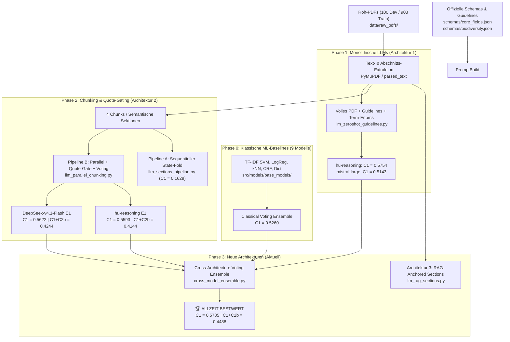
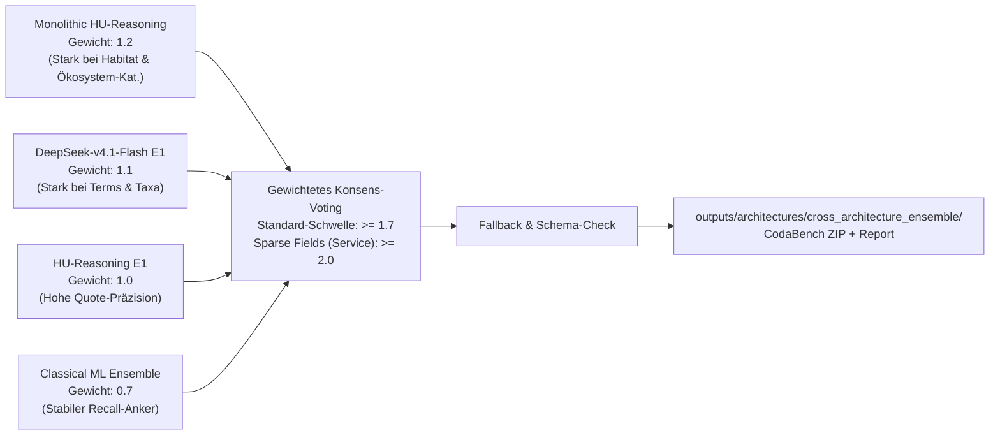
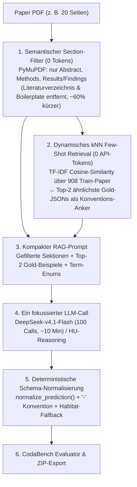

# Biodiversity Information Extraction (ANLP 2026 Shared Task C1 + C2b)
## Systemarchitektur, Datei-Übersicht & vollständige Experiment-Historie

Dieses Dokument fasst die gesamte Entwicklung unserer Extraktions-Pipelines zusammen: von den klassischen ML-Baselines über Monolithic & Chunked LLM-Ansätze bis hin zu unseren neuesten Top-Systemen (**Cross-Architecture Voting Ensemble** mit **0.5785 C1 Macro-F1** und der **RAG-Anchored Section Routing Pipeline**).

---

## 1. Gesamtbild & Evolution der Architekturen

---

## 2. Unsere zwei neuen Pipelines im Detail

### A) Cross-Architecture Voting Ensemble (`cross_model_ensemble.py`) — 🏆 **0.5785 C1 / 0.4488 C1+C2b**

**Idee:** Statt ein einzelnes Modell zu überfordern, kombinieren wir **4 heterogene Systeme**, die komplementäre Stärken besitzen — mit **0 zusätzlichen API-Calls** und in unter **2 Sekunden Laufzeit**:

**Gemessene Ergebnisse (100 Dev-Paper):**
- **C1 Leaderboard Macro-F1:** **`0.5785`** *(schlägt Monolithic `0.5754` und DeepSeek `0.5622`)*
- **C1 + C2b Macro-F1:** **`0.4488`** *(+2.44 F1-Punkte über dem bisherigen Rekord!)*
- **Micro-F1:** **`0.4300`**
- `habitat`: **0.7663** (81.3 % Präzision) | `biodiversity_level`: **0.4179** | `ecosystem_service.category`: **0.4545**

---

### B) Architektur 3: RAG-Anchored Section Routing (`llm_rag_sections.py`)

**Idee:** Lösen der beiden Hauptprobleme früherer Pipelines:
1. *Monolithisch* verschwendet Tokens an Literaturverzeichnisse und fängt sich Zitat-False-Positives ein.
2. *Blindes Chunking* verliert globalen Dokumentkontext und Gold-Formatkonventionen (z. B. *Auenwald $\rightarrow$ Fließende Gewässer*).

---

## 3. Datei-Wegweiser: Welche Datei macht was?

### Kern-Skripte (Pipelines & Evaluierung)
| Datei | Aufgabe & Funktion |
| :--- | :--- |
| `src/evaluation/evaluator.py` | **Offizieller CodaBench-Evaluator:** Set-basiertes Exact-Match (TP/FP/FN), C1 Macro-F1, C1+C2b Macro/Micro-F1, speichert `submission.zip` und aktualisiert das Leaderboard. |
| `src/models/architectures/cross_model_ensemble.py` | **Cross-Architecture Voting Ensemble:** Verrechnet die 4 heterogenen Prediction-Sets zu unserem aktuellen Spitzenreiter (`0.5785`). |
| `src/models/architectures/llm_rag_sections.py` | **Architektur 3 (RAG-Anchored Section Routing):** Section-Filter + TF-IDF kNN Train-Retriever + fokussierter LLM-Call + Schema-Normalisierung. |
| `src/models/architectures/llm_parallel_chunking.py` | **Architektur 2 / Pipeline B:** 4-Chunk Parallel-Extraktion mit Quote-Verification-Gate, Field-Guidelines (`--field-guidelines`) und Term-Enums (`--term-enum`). |
| `src/models/architectures/llm_sections_pipeline.py` | **Sections-Pipeline (A vs. B, EN vs. DE):** Vergleicht Parallel (B) vs. Sequentiellen Fold (A) sowie englische Extraktion + Mapping (`--language en`) vs. direktes Deutsch (`--language de`). |
| `src/models/architectures/llm_zeroshot_guidelines.py` | **Architektur 1 (Monolithisch):** Volltext-Prompting mit Guidelines + JSON-Repair + `OpenAICompatClient` + `DryRunMockClient`. |
| `src/models/base_models/*.py` | **9 klassische Baselines:** Majority, Random, Dictionary, TF-IDF LogReg, Naive Bayes, TF-IDF SVM, kNN Retrieval, CRF und Classical Voting Ensemble (`0.5260`). |

### Daten, Schemas & Dokumentation
| Pfad | Inhalt |
| :--- | :--- |
| `data/gold/dev.jsonl` & `dev_100_ids.txt` | Offizielles Dev-Benchmark-Set (100 validierte Paper). |
| `data/gold/train.jsonl` | 908 Trainings-Paper (Basis für Baselines & RAG-kNN-Anker). |
| `schemas/core_fields.json` & `biodiversity.json` | Offizielle Felddefinitionen und erlaubte Enum-Listen. |
| `outputs/all_models_comparison.md` | Zentrales Leaderboard mit allen gemessenen Läufen. |
| `outputs/error_analysis/gold_audit_report.md` | Manuelle Prüfung von 50 Dev-Papern (24 % fragwürdige Gold-Labels dokumentiert). |
| `docs/experiment_log.md` | Chronologisches Experiment-Protokoll. |

---

## 4. Vorgeschichte: Alle bisherigen Experimente & Erkenntnisse

1. **Klassische ML-Baselines (9 Modelle):**  
   Einzelmodelle wie TF-IDF SVM/LogReg oder kNN erreichten bis ~`0.48` C1 F1; das **Classical Voting Ensemble** erreichte **`0.5260`** — ein starker nicht-neuronaler Maßstab.
2. **Architektur 1 (Monolithisch):**  
   Das komplette Paper mit Guidelines an `hu-reasoning` erreichte **`0.5754` C1 Macro-F1**. `mistral-large` fiel wegen starker Über-Extraktion (1.166 False Positives vs. 542 bei HU) auf `0.5143` zurück.
3. **Architektur 2 / Pipeline B (Optimierungshebel):**
   - *Baseline v1 (`0.4318`):* `ecosystem_type.term` kollabierte auf `0.000` (strikte Normalisierung verwarf freie Zitate).
   - *v2 `--field-guidelines` (`0.4565`):* Präzise Feldregeln halbierten False Positives.
   - *E1 `--term-enum` (`0.5593` mit Qwen3.6-27B / **`0.5622` mit DeepSeek-v4.1-Flash**):* Mitgabe der 46/67 erlaubten Term-Enums + Relaxed Matching brachte **+10.3 F1-Punkte** und bei DeepSeek den C1+C2b-Sprung auf `0.4244`.
   - *E2 `--clean-text` (`0.4463`):* URLs/Referenzen stumpf abzuschneiden half allein nicht.
4. **Sprach- & Architektur-Vergleich (`llm_sections_pipeline.py`):**
   - **Englisch + deterministisches Mapping (`0.4476`) vs. Direkt Deutsch (`0.2498`):** **+19.8 F1-Punkte Vorsprung** für Englisch, da >85 % der Paper englisch sind und deutsche Zitat-Belege scheitern.
   - **Sequentieller State-Fold (`0.1629`):** Klares Negativergebnis — Context-Drift über mehrere Chunks zerstörte frühe Befunde.
5. **Gold-Label-Audit (`gold_audit_report.md`):**  
   50 Dev-Paper manuell geprüft: 76 % sauber, 24 % mit Gold-Rauschen (Strategiepapiere mit „Alles-Labels“, `Aue -> Fließende Gewässer`-Konvention, Autoren-Epitheta wie `Adonis aestivalis L.`). Das setzt eine natürliche Score-Obergrenze von ca. 10–15 % auf Dev.
