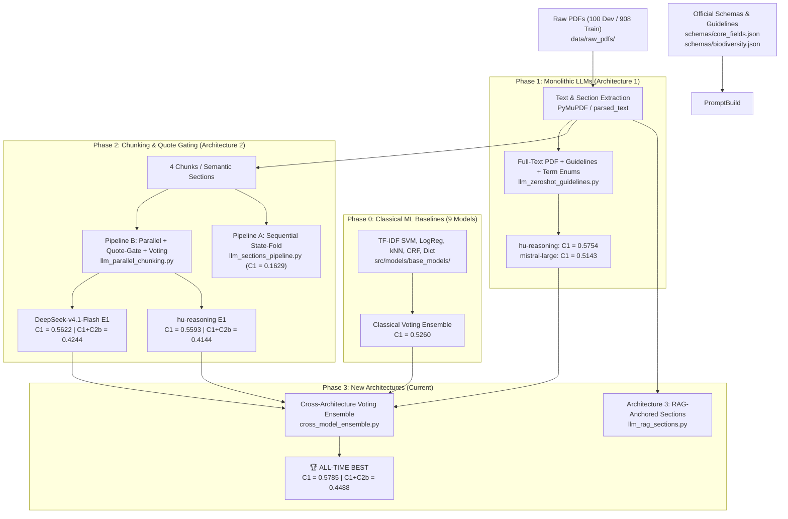
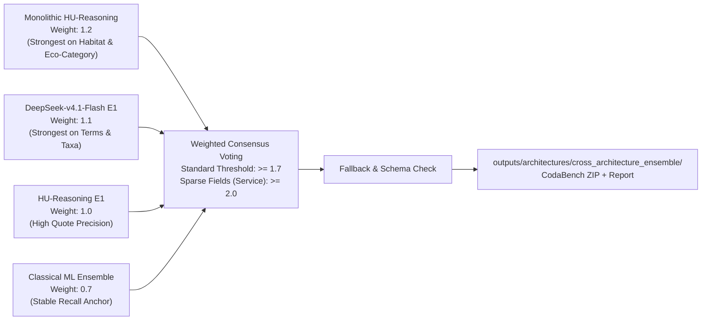
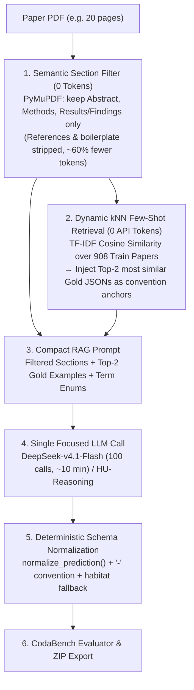

# Biodiversity Information Extraction (ANLP 2026 Shared Task C1 + C2b)
## System Architecture, File Map & Complete Experimental History

This document summarizes the full evolution of our extraction pipelines: from classical ML baselines and monolithic/chunked LLM approaches up to our newest top-performing systems (**Cross-Architecture Voting Ensemble** at **0.5785 C1 Macro-F1** and the **RAG-Anchored Section Routing Pipeline**).

---

## 1. Big Picture & Architecture Evolution

---

## 2. Our Two New Pipelines in Detail

### A) Cross-Architecture Voting Ensemble (`cross_model_ensemble.py`) — 🏆 **0.5785 C1 / 0.4488 C1+C2b**

**Core Idea:** Instead of relying on a single model, we combine **4 heterogeneous systems** with complementary strengths — requiring **0 extra API calls** and running in under **2 seconds**:

**Measured Results (100 Dev Papers):**
- **C1 Leaderboard Macro-F1:** **`0.5785`** *(beats Monolithic `0.5754` and DeepSeek `0.5622`)*
- **C1 + C2b Macro-F1:** **`0.4488`** *(+2.44 F1 points above previous best!)*
- **Micro-F1:** **`0.4300`**
- `habitat`: **0.7663** (81.3% precision) | `biodiversity_level`: **0.4179** | `ecosystem_service.category`: **0.4545**

---

### B) Architecture 3: RAG-Anchored Section Routing (`llm_rag_sections.py`)

**Core Idea:** Solves the two main bottlenecks of earlier approaches:
1. *Monolithic* wastes tokens on bibliographies/references and suffers from background-citation False Positives.
2. *Blind Chunking* loses global document context and annotator conventions (e.g., *floodplain forest $\rightarrow$ Running Waters*).

---

## 3. File Map: What File Does What?

### Core Scripts (Pipelines & Evaluation)
| File | Role & Functionality |
| :--- | :--- |
| `src/evaluation/evaluator.py` | **Official CodaBench Evaluator:** Set-based exact match (TP/FP/FN), C1 Macro-F1, C1+C2b Macro/Micro-F1, exports `submission.zip`, and updates the central leaderboard. |
| `src/models/architectures/cross_model_ensemble.py` | **Cross-Architecture Voting Ensemble:** Merges our 4 heterogeneous prediction sets to achieve our current all-time best (`0.5785`). |
| `src/models/architectures/llm_rag_sections.py` | **Architecture 3 (RAG-Anchored Section Routing):** Section filtering + TF-IDF kNN train retriever + focused LLM call + schema normalization. |
| `src/models/architectures/llm_parallel_chunking.py` | **Architecture 2 / Pipeline B:** 4-chunk parallel extraction with quote-verification gate, field guidelines (`--field-guidelines`), and term enums (`--term-enum`). |
| `src/models/architectures/llm_sections_pipeline.py` | **Sections Pipeline (A vs. B, EN vs. DE):** Compares Parallel (B) vs. Sequential Fold (A) as well as English extraction + mapping (`--language en`) vs. direct German (`--language de`). |
| `src/models/architectures/llm_zeroshot_guidelines.py` | **Architecture 1 (Monolithic):** Full-text prompting with guidelines + JSON repair + `OpenAICompatClient` + `DryRunMockClient`. |
| `src/models/base_models/*.py` | **9 Classical Baselines:** Majority, Random, Dictionary, TF-IDF LogReg, Naive Bayes, TF-IDF SVM, kNN Retrieval, CRF, and Classical Voting Ensemble (`0.5260`). |

### Data, Schemas & Documentation
| Path | Contents |
| :--- | :--- |
| `data/gold/dev.jsonl` & `dev_100_ids.txt` | Official Dev benchmark set (100 validated papers). |
| `data/gold/train.jsonl` | 908 training papers (used for baselines & RAG-kNN anchors). |
| `schemas/core_fields.json` & `biodiversity.json` | Official field specifications and allowed enum lists. |
| `outputs/all_models_comparison.md` | Central leaderboard across all evaluated runs. |
| `outputs/error_analysis/gold_audit_report.md` | Manual audit of 50 Dev papers (24% questionable gold labels documented). |
| `docs/experiment_log.md` | Chronological experiment log. |

---

## 4. Background History: Previous Experiments & Key Findings

1. **Classical ML Baselines (9 Models):**  
   Single models like TF-IDF SVM/LogReg or kNN reached up to ~`0.48` C1 F1; the **Classical Voting Ensemble** reached **`0.5260`** — a strong non-neural benchmark.
2. **Architecture 1 (Monolithic):**  
   Feeding full text with guidelines to `hu-reasoning` achieved **`0.5754` C1 Macro-F1**. `mistral-large` dropped to `0.5143` due to heavy over-extraction (1,166 False Positives vs. 542 for HU).
3. **Architecture 2 / Pipeline B (Optimization Levers):**
   - *Baseline v1 (`0.4318`):* `ecosystem_type.term` collapsed to `0.000` (strict normalization dropped free-text quotes).
   - *v2 `--field-guidelines` (`0.4565`):* Thorough field rules halved False Positives.
   - *E1 `--term-enum` (`0.5593` with HU / **`0.5622` with DeepSeek-v4.1-Flash**):* Providing the 46/67 allowed term enums + relaxed matching added **+10.3 F1 points**, and pushed DeepSeek C1+C2b to `0.4244`.
   - *E2 `--clean-text` (`0.4463`):* Stripping URLs/references alone did not help.
4. **Language & Architecture Comparison (`llm_sections_pipeline.py`):**
   - **English + deterministic mapping (`0.4476`) vs. Direct German (`0.2498`):** **+19.8 F1 points advantage** for English, because >85% of papers are written in English and German verbatim quote matching fails.
   - **Sequential State-Fold (`0.1629`):** Clear negative result — context drift across chunks eroded early findings.
5. **Gold-Label Audit (`gold_audit_report.md`):**  
   Manual inspection of 50 Dev papers: 76% clean, 24% gold noise (policy documents with "all-labels", *floodplain $\rightarrow$ Running Waters* convention, author epithets like `Adonis aestivalis L.`). This creates a natural score ceiling on ~10–15% of the Dev set.
